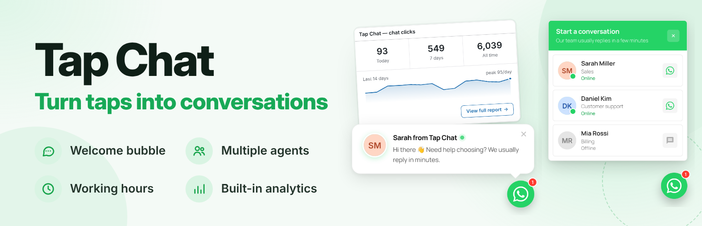
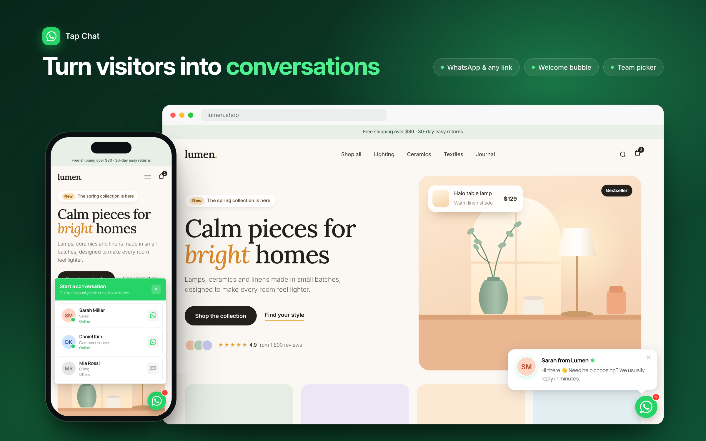
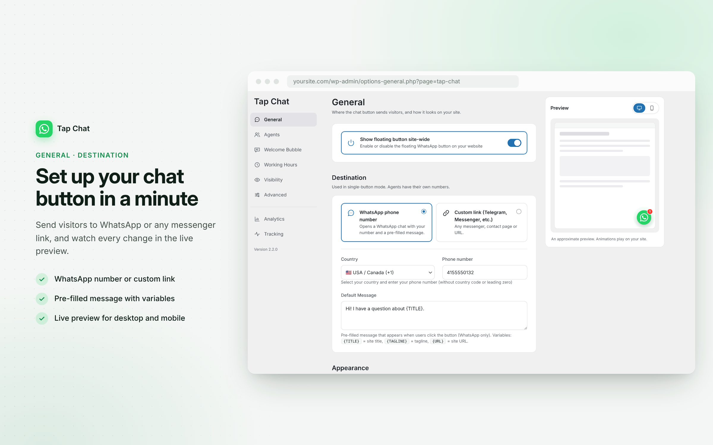
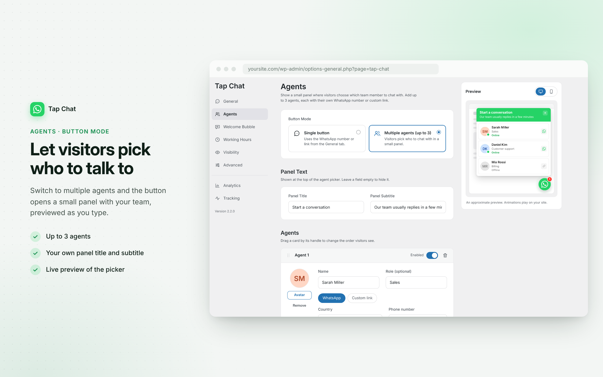
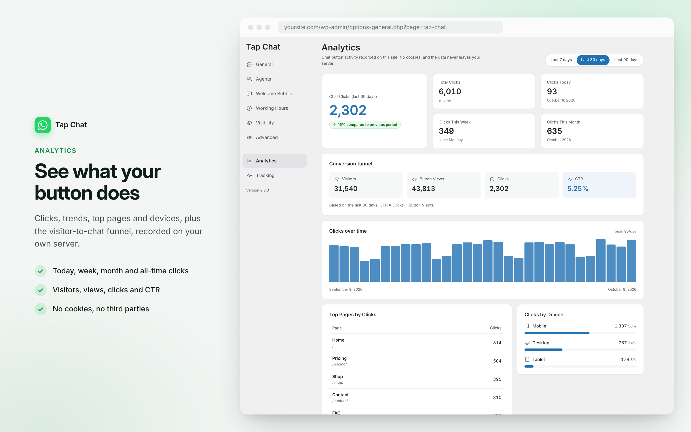

# Tap Chat – Floating Contact Button

**Version:** 2.2.0 | **Requires:** WordPress 5.8+ | **Tested up to:** 7.1 | **PHP:** 7.4+

[](https://wordpress.org/plugins/tap-chat/)
[](https://wordpress.org/plugins/tap-chat/)
[](https://www.gnu.org/licenses/gpl-2.0.html)



WhatsApp chat button for WordPress with multiple agents, a welcome bubble, working hours, page rules and privacy-first click analytics. No cookies, no third parties.

**New in 2.2:** a redesigned settings screen with a side menu, clear sections and a **live preview** that shows the button, the agent picker and the welcome bubble on desktop and mobile as you edit. It follows your WordPress admin colour scheme and works in right-to-left languages.

- 🔗 [WordPress.org plugin page](https://wordpress.org/plugins/tap-chat/)
- 🎬 [Demo](https://wpdevup.com/tap-chat/)
- 💬 [Support forum](https://wordpress.org/support/plugin/tap-chat/)

## 📸 Screenshots

| The button on your site | Live preview while you edit |
| --- | --- |
|  |  |
| **Multiple agents** | **Built-in analytics** |
|  |  |

## 🚀 Features

### Core Features
- 👀 **Live Preview** - See the button, the agent picker and the welcome bubble change as you edit, on desktop and mobile
- 👥 **Multiple Agents** - Up to 3 team members in a compact picker panel, each with their own WhatsApp number or link, avatar, role and online status
- 📊 **Built-in Analytics** - First-party chat-click report inside wp-admin: no cookies, no personal data, no external requests
- ✨ **Floating Chat Button** - Customizable button that stays in the corner of your site, icon-only or with a label
- 🔗 **Custom Link** - Use Telegram, Messenger, a contact page, `tel:`, `mailto:` or any URL instead of WhatsApp
- 🎨 **Custom Icon Upload** - Replace the WhatsApp icon with your own logo
- 💬 **Welcome Bubble** - Friendly greeting in Modern or Simple style
- 🎯 **Smart Triggers** - Show the bubble on time on page, scroll depth, exit intent or idle
- 🌀 **Button Animations** - Fade in, slide in, bounce, ring, or a "New message" badge with a pulsing ring (respects reduced-motion)
- 🌍 **Country Selector** - 150+ country codes with flags
- ⏰ **Working Hours** - Show the button only during business hours, in your time zone, with an optional offline message
- 👁️ **Page Visibility** - Show only on selected pages, or hide on selected pages
- 📈 **GA4 / Tag Manager** - Optionally forward chat clicks and bubble impressions to the analytics you already use
- 📱 **Mobile Optimized** - Separate desktop and mobile sizes and label settings
- ↔️ **RTL Ready** - Admin and front end lay out correctly in right-to-left languages
- 🌐 **Translation Ready** - Fully translatable with the included `.pot` file

### Multiple Agents

Let visitors pick who to talk to instead of guessing.

- **Up to 3 agents**, each opening their own chat in a new tab
- **WhatsApp number or custom link per agent** (Telegram, Messenger, `tel:`, `mailto:`, any URL)
- **Per-agent details**: name, role, avatar and a pre-filled WhatsApp message
- **Manual online / offline** status with a green dot
- **Custom panel title and subtitle**
- **Drag to reorder** in the admin
- **GA4 / Tag Manager aware**: the chosen agent's name is sent as the event label
- **Non-destructive**: single-button setups keep working; switch modes any time under **Settings → Tap Chat → Agents**

### Built-in Analytics

Everything is stored in your own WordPress database.

- **Headline metrics**: Total, Today, This Week and This Month chat clicks, with the change versus the previous period
- **Top pages** by clicks and **clicks by device** (mobile / desktop / tablet)
- **Optional traffic tracking** for the Visitors → Button Views → Clicks → CTR funnel (off by default)
- **Dashboard widget** with today / last 7 days / all-time clicks and a 14-day trend
- **Privacy by design**: no cookies, IP addresses and user agents are never stored, no external requests
- **You stay in control**: exclude logged-in users, choose how long data is kept (pruned daily), reset all data at any time

### Welcome Bubble

**Modern style:** avatar, name, online indicator and message, shown above the button.

**Simple style:** message only, shown above or beside the button.

**Smart Triggers** (when several are enabled, the first condition met shows the bubble):
- ⏱️ **Time on Page** - after the visitor stays X seconds (recommended)
- 📜 **Scroll Depth** - when the visitor scrolls to X% of the page
- 🚪 **Exit Intent** - when the mouse moves to close the tab
- 💤 **Idle Detection** - when the visitor is inactive for X seconds

A closed bubble stays closed for the rest of the session.

## 📦 Installation

### From WordPress.org

1. Go to **Dashboard → Plugins → Add New**
2. Search for "**Tap Chat**"
3. Click **Install Now**, then **Activate**
4. Go to **Settings → Tap Chat** to configure

### Manual Installation

1. Download the latest release from [WordPress.org](https://wordpress.org/plugins/tap-chat/)
2. Upload the `tap-chat` folder to `/wp-content/plugins/`
3. Activate it from the **Plugins** screen
4. Configure it under **Settings → Tap Chat**

### For Developers

```bash
git clone https://github.com/wpdevup/tap-chat.git
ln -s "$(pwd)/tap-chat" /path/to/wordpress/wp-content/plugins/tap-chat
```

## ⚙️ Configuration

All settings live on one screen, **Settings → Tap Chat**, with a side menu. Each section has its own link (for example `#agents`), and after saving you stay on the section you were editing. The General, Agents and Welcome Bubble sections show a live preview for desktop and mobile.

1. **General**
   - Destination: WhatsApp number (country + phone) or any custom link
   - Pre-filled message, with `{TITLE}`, `{TAGLINE}` and `{URL}` placeholders
   - Appearance: label, colour, position, animation, custom icon, separate desktop and mobile sizes
2. **Agents**
   - Single button or multiple agents
   - Panel title and subtitle, up to 3 agents with their own channel, avatar, role and status
3. **Welcome Bubble**
   - Modern or Simple style, message, name and avatar
   - Smart Triggers
4. **Working Hours**
   - Schedule per day, time zone, optional offline message
5. **Visibility**
   - Show only on selected pages, or hide on selected pages
6. **Advanced**
   - Append the page title and URL to every message
7. **Analytics**
   - The built-in report with a 7 / 30 / 90-day range
8. **Tracking**
   - Built-in click and traffic tracking, data retention, reset
   - Optional Google Analytics 4 / Tag Manager events

## 🧩 Shortcode

Display a chat link anywhere:

```text
[tapchat]
```

With custom parameters:

```text
[tapchat phone="+1234567890" message="Hello!" label="Contact us"]
```

## 🎨 Customization

### CSS

Override styles in your theme:

```css
/* Button colour */
.tapchat-fab {
    --tapchat-color: #128c7e;
}

/* Welcome bubble */
.tapchat-welcome-bubble {
    border-radius: 20px;
}

/* Button offset */
.tapchat-fab.tapchat-pos-right {
    bottom: 30px;
    right: 30px;
}
```

### PHP Filters

```php
// Hide the floating button on any view you choose, e.g. all blog posts.
add_filter( 'tap_chat_suppress_button', function ( $suppress ) {
    return is_singular( 'post' ) ? true : $suppress;
} );

// Keep other plugins' admin notices visible on the Tap Chat settings screen.
add_filter( 'tap_chat_quiet_admin_notices', '__return_false' );

// Change the number of days before the review request notice appears.
add_filter( 'tap_chat_review_delay_days', function () {
    return 14;
} );
```

### JavaScript

```javascript
// Runs when the chat button is clicked (requires wp.hooks on the page).
wp.hooks.addAction( 'tapchat_click', 'my-namespace', function () {
    // Your own tracking.
} );
```

### Google Analytics 4 / Tag Manager Events

When enabled under **Tracking**, Tap Chat sends events through the `gtag` or `dataLayer` already on your site (it never loads an analytics library itself):

- `tapchat_click` (the event name can be changed) - chat button, bubble or agent clicks; the agent name is sent as the label
- `tapchat_bubble_shown` - welcome bubble impressions, with the `trigger_type` that showed it

## 🛠️ Development

### Requirements
- WordPress 5.8 or higher
- PHP 7.4 or higher

### File Structure

```text
tap-chat/
├── assets/
│   ├── css/
│   │   ├── tapchat.css                       # Front-end styles
│   │   ├── admin.css                         # Settings screen
│   │   └── admin-global.css                  # Notices and dashboard widget
│   └── js/
│       ├── tapchat.js                        # Front-end script
│       └── admin.js                          # Settings screen and live preview
├── includes/
│   ├── class-tap-chat.php                    # Main plugin class (front end)
│   ├── class-tap-chat-analytics-store.php    # Analytics table and queries
│   ├── class-tap-chat-rest.php               # Click and view collector endpoint
│   └── admin/
│       ├── class-tap-chat-admin.php          # Settings screen shell, notices, dashboard widget
│       ├── class-tap-chat-settings.php       # Option registration, defaults and sanitizing
│       ├── class-tap-chat-fields.php         # Section views and live preview
│       ├── class-tap-chat-dashboard.php      # Analytics report
│       ├── class-tap-chat-review.php         # Review request notice
│       ├── class-tap-chat-ui.php             # Shared admin UI helpers
│       └── class-tap-chat-icons.php          # Admin icon set
├── languages/
│   └── tap-chat.pot                          # Translation template
├── tap-chat.php                              # Plugin entry point
├── uninstall.php                             # Cleanup on uninstall
└── readme.txt                                # WordPress.org readme
```

### Coding Standards

- [WordPress Coding Standards](https://developer.wordpress.org/coding-standards/)
- [WordPress Plugin Handbook](https://developer.wordpress.org/plugins/)
- [WordPress Security Best Practices](https://developer.wordpress.org/plugins/security/)

### Building for Production

```bash
# Coding standards
phpcs --standard=WordPress tap-chat.php includes/

# Translation template
wp i18n make-pot . languages/tap-chat.pot --slug=tap-chat

# Release package
zip -r tap-chat.zip tap-chat -x "*.git*" "*.DS_Store"
```

## 🧪 Testing Checklist

- [ ] Button shows on the front end, single and multiple-agents modes
- [ ] Live preview matches the front end on desktop and mobile
- [ ] Welcome bubble appears with each enabled trigger
- [ ] Working hours and offline message behave correctly
- [ ] Visibility rules work as expected
- [ ] Analytics record clicks (and views when traffic tracking is on)
- [ ] Settings save and you stay on the same section
- [ ] Left-to-right and right-to-left layouts
- [ ] No JavaScript console errors, no PHP notices with `WP_DEBUG`

## 🔒 Privacy & Performance

- **No external requests** - nothing is loaded from third parties
- **Small footprint** - one stylesheet and one script on the front end, using the jQuery bundled with WordPress
- **First-party analytics** - daily-aggregated counts in your own database, sent with a non-blocking beacon; no cookies and no personal data
- **Clean uninstall** - the analytics table and settings are removed on uninstall

## 🛡️ Security

- All inputs sanitized and validated, all output escaped
- Nonces and capability checks for admin actions
- Prepared database queries

Found a security issue? Please report it privately through the [WordPress.org support forum](https://wordpress.org/support/plugin/tap-chat/).

## 🌍 Translations

Tap Chat is translation-ready. Contribute a translation on [translate.wordpress.org](https://translate.wordpress.org/projects/wp-plugins/tap-chat/), or use `languages/tap-chat.pot` with [Poedit](https://poedit.net/).

## 🤝 Contributing

1. **Code** - fork the repository, create a feature branch, and open a pull request
2. **Bug reports** - open a [GitHub issue](https://github.com/wpdevup/tap-chat/issues) with steps to reproduce and screenshots
3. **Feature requests** - open an issue with the `[FEATURE]` prefix and describe the use case
4. **Translations** - via translate.wordpress.org

## 📝 Changelog

### [2.2.0] - 2026-10-08
A redesigned settings screen: calmer, clearer, and easier to scan.

**New:**
- Redesigned admin: one screen with a side navigation, card sections, switches and option cards
- Live preview of the button, the agent picker and the welcome bubble on desktop and mobile
- Notices from other plugins are hidden on the Tap Chat screen (filter: `tap_chat_quiet_admin_notices`)
- Admin follows your WordPress admin colour scheme and supports right-to-left languages
- You stay on the section you were editing after saving; section links open directly

**Improved:**
- Analytics report, dashboard widget and notices share the same visual style
- Analytics settings moved to their own "Tracking" section

**Fixed:**
- Welcome-bubble avatar no longer falls back to the Custom Icon
- Modern welcome bubble avatar position on right-to-left sites
- Button no longer appears inside block widget editor previews or counts them as views
- Opening the agent picker with a mouse no longer highlights the first agent with the theme's focus style
- Times of a day switched off under Working Hours are kept when saving

**Developer:**
- Admin markup without inline styles, rendered by dedicated view classes; option format unchanged

### [2.1.0] - 2026-09-13
**New:**
- Multiple Agents mode with up to 3 team members, each with their own WhatsApp number or link, avatar, role and pre-filled message
- Per-agent online / offline indicator, panel title and subtitle, drag-to-reorder
- Agent name forwarded to GA4 / Tag Manager
- Setup notice after activation that links to the settings

**Improved:**
- Button label hidden on desktop by default for new installs
- Existing single-button setups are untouched

**Fixed:**
- RTL "Side" welcome bubble position and close-button layout with some themes

### [2.0.0] - 2026-09-05
**New:**
- Built-in, privacy-first analytics dashboard (Total / Today / This Week / This Month, top pages, devices, 7 / 30 / 90-day range)
- Optional traffic and CTR tracking with cookieless unique visitors
- WordPress dashboard widget
- Exclude logged-in users, data retention with daily pruning, and a reset action

### [1.9.0] - 2026-07-13
- GA4 / Google Tag Manager events for chat clicks and welcome-bubble impressions

### [1.8.0] - 2026-07-13
- Button animations: fade in, slide in, bounce, ring and "New message" badge
- Review request notice (filter: `tap_chat_review_delay_days`)

### [1.7.0] - 2026-07-05
- Phone / Custom-link toggle for any URL
- `{TITLE}`, `{TAGLINE}` and `{URL}` placeholders in the default message

### [1.6.0] - 2025-11-27
- JavaScript tabs in the admin and single-submission saving
- Dynamic bubble positioning that follows the icon size

### [1.5.0] - 2025-11-25
- Custom Icon Upload with the WordPress Media Library

### [1.4.0] - 2025-11-21
- Smart Triggers: time on page, scroll depth, exit intent, idle detection

### [1.3.0] - 2025-08-15
- Welcome Bubble with Modern and Simple styles

### [1.2.0] - 2025-06-10
- Business hours with time zone support, offline message, page visibility controls

### [1.1.0] - 2025-04-20
- Country selector, separate mobile and desktop sizes, page context appending

### [1.0.0] - 2025-03-01
- Initial release

The full changelog is in [readme.txt](readme.txt).

## 🗺️ Roadmap

### Completed ✅
- ✅ Redesigned admin with live preview (v2.2.0)
- ✅ Multiple agents (v2.1.0)
- ✅ Built-in privacy-first analytics (v2.0.0)
- ✅ GA4 / Tag Manager events (v1.9.0)
- ✅ Button animations (v1.8.0)
- ✅ Custom links (v1.7.0)
- ✅ Custom icon upload (v1.5.0)
- ✅ Smart triggers (v1.4.0)
- ✅ Welcome bubble (v1.3.0)
- ✅ Working hours (v1.2.0)

### Ideas 🚀
- [ ] More bubble styles
- [ ] Pre-chat form
- [ ] Quick reply templates

## 📜 License

GPL v2 or later.

```text
Tap Chat – Floating Contact Button
Copyright (C) 2025-2026 WPdevup

This program is free software; you can redistribute it and/or modify
it under the terms of the GNU General Public License as published by
the Free Software Foundation; either version 2 of the License, or
(at your option) any later version.

This program is distributed in the hope that it will be useful,
but WITHOUT ANY WARRANTY; without even the implied warranty of
MERCHANTABILITY or FITNESS FOR A PARTICULAR PURPOSE. See the
GNU General Public License for more details.
```

## 📞 Support

- 📖 [Documentation](https://wordpress.org/plugins/tap-chat/)
- 💬 [Support forum](https://wordpress.org/support/plugin/tap-chat/)
- 🐛 [Report a bug](https://github.com/wpdevup/tap-chat/issues)
- ⭐ [Rate the plugin](https://wordpress.org/support/plugin/tap-chat/reviews/)

---

Made with ❤️ by [WPdevup](https://wpdevup.com/tap-chat/) and [iruserwp9](https://profiles.wordpress.org/iruserwp9/) for the WordPress community.

[WordPress.org](https://wordpress.org/plugins/tap-chat/) | [GitHub](https://github.com/wpdevup/tap-chat) | [Support](https://wordpress.org/support/plugin/tap-chat/)
